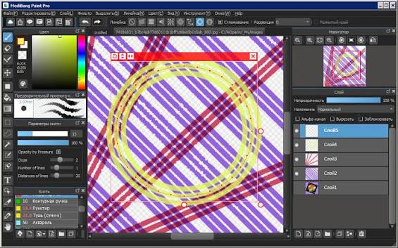
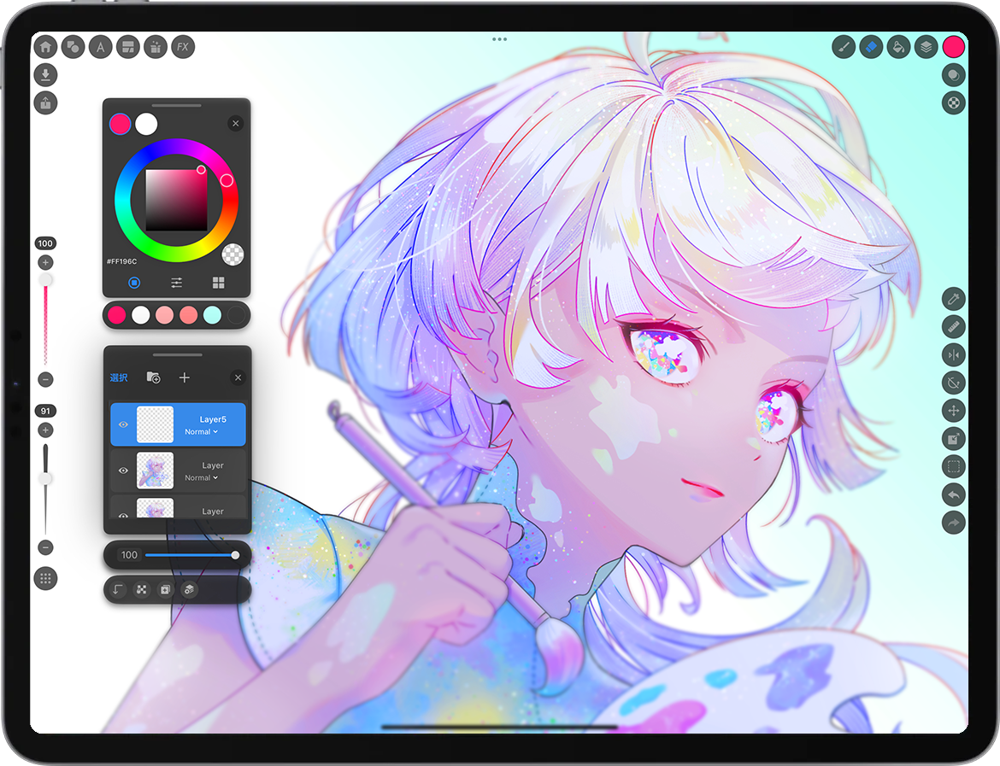

# MediBang Paint Illustration and Comic Creation Workflow

MediBang Paint brings sketching, painting, and comic page work into a layered drawing workspace.
Keep an editable project while preparing separate images for review, publication, or printing.

[](https://github.com/pricek998189/medibang-paint/releases/)

This guide focuses on MediBang Paint for Desktop.
Product names, document formats, and review steps are kept explicit so that artwork remains easy to hand over.

## Product Identity

Searches for **medibang paint pro** often refer to the desktop application.
Check the exact product name when comparing store listings, older tutorials, and mobile editions.

| Product name | Relationship | What to check |
| --- | --- | --- |
| MediBang Paint for Desktop | Desktop drawing and comic application | Desktop edition and installed version |
| MediBang Paint for mobile devices | Device-specific editions in the Paint family | Controls and features on that device |
| **medibang pro** | Former name of the separate Paletta application | Avoid confusing it with Paint Pro |
| **medibang paletta** | Separate drawing product | Its own documentation and release history |
| **jump paint by medibang** | Separate manga creation application | Its own tutorials and supported environment |

The version reference used here is 32.7 from the macOS desktop listing.
Do not apply that version number to every application in the product family.

## Drawing Features

- Sketch with editable brushes and adjust the tool to the kind of mark you need.
- Separate line work, color, lettering, and backgrounds into layers.
- Use stabilization when a steadier stroke helps with inking.
- Apply perspective guides when constructing rooms, streets, or repeated forms.
- Arrange comic panels and prepare page artwork.
- Add screentones where patterned shading suits the page.
- Keep text editable while wording and placement are still being reviewed.

Choose a small brush set for a project and test it on a spare layer.
A brush that works well for rough drawing may need different settings for final lines.



## Canvas Planning

Decide whether the deliverable is a screen image, a printed page, or both.
Write down the required pixel dimensions before drawing detailed textures or lettering.

For print planning, convert physical size and the requested pixel density into a target pixel count.
The following PowerShell calculation is independent of MediBang Paint and changes no artwork.

```powershell
$widthMm = 148
$heightMm = 210
$ppi = 300
$widthPx = [math]::Ceiling($widthMm / 25.4 * $ppi)
$heightPx = [math]::Ceiling($heightMm / 25.4 * $ppi)
"{0} x {1} pixels" -f $widthPx, $heightPx
```

This example gives 1749 x 2481 pixels for a 148 x 210 mm page at 300 pixels per inch.
Use the printer's specifications for bleed, trim, margins, and final delivery requirements.
The calculation does not add bleed or set any document properties.

### Working Size

- Reserve room for captions and speech balloons before finishing the illustration.
- Compare the composition at full view and at its intended reading size.
- Keep an untouched project copy before changing the canvas dimensions.
- Inspect fine lines again after reducing an image for publication.

## Layer Organization

Use names that describe the content and purpose of each layer.
A short, consistent naming scheme makes later corrections easier to locate.

| Suggested layer name | Content | Review question |
| --- | --- | --- |
| Rough | Composition and construction lines | Is it hidden in the delivery image? |
| Ink | Finished contours | Are small gaps visible at reading size? |
| Color | Base colors and painted details | Are edges clean against the background? |
| Tone | Patterned shading | Does the pattern survive the final scale? |
| Lettering | Dialogue and captions | Can the text be read comfortably? |

These are suggested document labels, not required layer names or a built-in template.
Adapt them to a single illustration, a comic page, or a longer project.

### When a Brush Appears Unresponsive

Check the selected layer before changing your tablet or brush settings.
A locked layer, a hidden layer, a text layer, or a layer folder can explain why painting does not appear.

- Select the intended drawing layer.
- Confirm that it is visible and unlocked.
- Check whether the selected layer type supports the current brush.
- Make a small test mark on a suitable temporary layer.

## Comic Page Review

Review panel order before spending time on small surface details.
A readable page should guide the eye through the intended sequence.

- Check that adjacent panels have enough visual separation.
- Leave sufficient room around dialogue.
- Compare lettering size between panels.
- Check screentones at the final export dimensions.
- Confirm that construction marks are absent from the delivery image.



## Editable Projects and Delivery Images

Save the working document as MDP when you need to preserve its layers.
Prepare a separate delivery image rather than relying on a flattened export as the only project copy.

| Format | Useful role | Practical check |
| --- | --- | --- |
| MDP | Editable working document | Reopen it and inspect the layer structure |
| PNG | Finished illustration or transparent asset | Choose the appropriate transparency option |
| JPEG | Compact image preview | Check compression around lines and text |
| PSD | Layered exchange with another application | Check the result in the receiving editor |

PNG exports merge the layer content into an image.
A transparent PNG preserves transparent areas; the 24-bit PNG option does not preserve transparency.
JPEG compression is lossy, so retain the original editable project for further changes.

### Save Checkpoints

Use File > Save for the current document.
Use File > Save As when you want a separate revision while keeping the earlier file.

For example, distinguish a page's rough, inked, and approved revisions in your own naming scheme.
Reopen an important checkpoint before depending on it for a handoff.

## Export Inspection

After exporting, inspect the actual delivery file rather than judging only the open canvas.
Check its dimensions, transparency, visible content, and readability.

If ImageMagick is already available, these PowerShell commands inspect an exported PNG.
They belong to ImageMagick and are not MediBang Paint command-line options.

```powershell
$export = '.\page-01.png'
magick identify $export
magick identify -verbose $export
```

The first command gives a compact image summary.
The verbose report exposes additional image properties for inspection.
Neither command resizes, repaints, or overwrites the export.

### Delivery Checklist

- Confirm the intended page or illustration was exported.
- Inspect the image against both light and dark backgrounds if transparency matters.
- Read all dialogue at the expected display size.
- Compare the export with the approved project revision.
- Preserve the matching MDP document alongside the delivered image.

## Cloud and Device Handoffs

MediBang Paint offers cloud features that require a MediBang account and an internet connection.
Available services and limits can depend on the edition or account plan.

Before changing devices, confirm that the intended project revision is available at the destination.
Keep a local working copy when you need an independent recovery point.

- Check the product and platform on both devices.
- Confirm which project revision your collaborator should review.
- Compare the opened document with the agreed reference image.
- Resolve discrepancies before continuing detailed edits.

A shared project does not remove the need to identify the approved revision.
Record the page name and revision clearly when collecting feedback.

## Related Search Terms

medibang paint, medibang paint pro, medibang pro, medibang paletta, jump paint by medibang, digital-painting, drawing, illustration, comics, manga, raster-graphics, brushes, layers, graphics-tablet, image-editing
